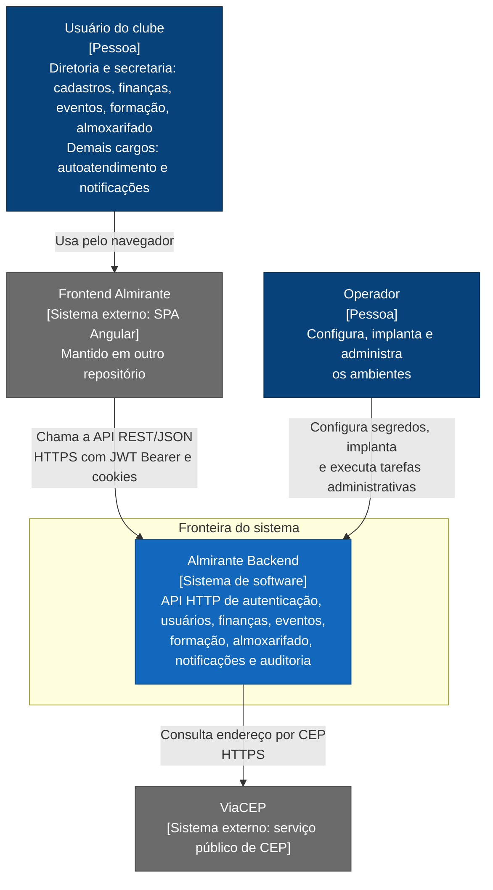

# C4: contexto do sistema

Este documento mostra o Almirante Backend como uma caixa só: quem o usa e com quais sistemas ele se
relaciona. É o nível 1 do modelo C4 (System Context). Os containers internos (nginx, API, SQL Server)
estão em [`c4-container.md`](c4-container.md).

Levantado em 2026-09-23 (`57f24dd`) e conferido de novo em 2026-10-27 (issue #160, `20a450d`). Veja como manter este documento
atualizado em [`README.md`](README.md#como-manter-a-documentação-atualizada).

## Diagrama

Legenda: o tipo de cada elemento aparece entre colchetes. Pessoas em azul-escuro, o sistema
documentado em azul e sistemas externos em cinza.

## Elementos

| Elemento | Tipo | Descrição | Evidência |
| --- | --- | --- | --- |
| Almirante Backend | Sistema de software | API HTTP que centraliza autenticação e senhas, usuários, cargos, lançamentos e pagamentos, eventos com cobrança por membro, dashboard, notificações em tempo real, formação, almoxarifado e auditoria HTTP. Inclui o reverse proxy, a API e o banco (ver [`c4-container.md`](c4-container.md)). | [`README.md`](../../README.md), [`rastreabilidade.md`](../rastreabilidade.md) |
| ViaCEP | Sistema externo | Serviço público consultado por CEP para preencher e validar o endereço de usuários. Indisponível ou fora do contrato, a API responde `503` sem gravar nada. | [`ViaCepClient.cs`](../../src/Almirante.Api/Services/ViaCepClient.cs), [`README.md`](../../README.md#autenticação) |
| Frontend Almirante | Sistema externo | SPA Angular mantida em outro repositório. É o cliente da API usado pelos usuários. | [`docs/authentication-security.md`](../authentication-security.md#contrato-da-spa-e-csrf), `Cors:AllowedOrigins` em [`Program.cs`](../../src/Almirante.Api/Program.cs) e [`appsettings.json`](../../src/Almirante.Api/appsettings.json), PR #1 |
| Usuário do clube | Pessoa | Usuário cadastrado, com um cargo ativo. O que cada cargo acessa está na [matriz por endpoint](../authentication-security.md#perfis-e-matriz-de-acesso-31-127): diretoria (ADM, DIR, DIRA) acessa os módulos de negócio; SEC cuida de cadastros, eventos e formação; TES do financeiro e dos eventos; ALM ou o responsável designado do almoxarifado; todos usam o autoatendimento e as próprias notificações. | [`Roles.cs`](../../src/Almirante.Api/Security/Roles.cs), policies em [`Program.cs`](../../src/Almirante.Api/Program.cs), [`AuthorizationTests.cs`](../../src/Almirante.Api.Tests/AuthorizationTests.cs) |
| Operador | Pessoa | Quem mantém os ambientes. Define segredos no `.env` ou em user-secrets, publica por push em `develop`, executa o bootstrap SQL, usa a CLI `reset-admin-password` e, opcionalmente, cria a identidade de consulta `adm-ti`. | [`README.md`](../../README.md), [`AdminPasswordResetCli.cs`](../../src/Almirante.Api/Cli/AdminPasswordResetCli.cs), [`docs/sql/`](../sql), [`backend-deploy.yml`](../../.github/workflows/backend-deploy.yml) |

## Relações

| De | Para | Descrição | Evidência |
| --- | --- | --- | --- |
| Usuário do clube | Frontend Almirante | Usa a aplicação no navegador. | [`docs/authentication-security.md`](../authentication-security.md#contrato-da-spa-e-csrf) |
| Frontend Almirante | Almirante Backend | Chama a API REST/JSON por HTTPS e recebe avisos pelo hub SignalR `/hubs/notificacoes`. Envia o access token em `Authorization: Bearer` e usa cookies para refresh token e CSRF, com CORS por credenciais. | [`AuthController.cs`](../../src/Almirante.Api/Controllers/AuthController.cs), [`Program.cs`](../../src/Almirante.Api/Program.cs) (`AddCors`, `AddAntiforgery`), [ADR-0001](adr/0001-usar-jwt-com-sessoes-persistidas-e-refresh-rotativo.md) |
| Operador | Almirante Backend | Configura segredos e ambiente, implanta e executa tarefas administrativas (bootstrap SQL, reset de senha do administrador, consultas de TI). | [`compose.yaml`](../../compose.yaml), [`.env.example`](../../.env.example), [`scripts/sql-bootstrap.sh`](../../scripts/sql-bootstrap.sh), [ADR-0005](adr/0005-separar-identidades-sql-e-rotacionar-credenciais.md) |

## Fronteira do sistema

Dentro da fronteira ficam o nginx, a API ASP.NET Core, o SQL Server e o container de bootstrap SQL,
descritos em [`c4-container.md`](c4-container.md). O banco de dados pertence ao próprio sistema: nenhum
outro sistema versionado neste repositório acessa as tabelas. A consulta humana opcional pela
identidade `adm-ti` passa por views dedicadas do schema `ti`
([`docs/sql/criar-usuario-adm-ti.sql`](../sql/criar-usuario-adm-ti.sql)).

Fora da fronteira ficam o frontend (outro repositório) e as pessoas.

## O que não aparece neste diagrama e por quê

- **Outras integrações externas de runtime:** além do ViaCEP, não existem. A API não envia e-mail, não usa filas, cache
  distribuído nem provedor de identidade externo. Fotos e o diário da auditoria HTTP ficam em disco local, fora do site.
- **GitHub Actions:** o CI e o deploy entregam o sistema, mas não participam do funcionamento em
  runtime. Estão descritos em [`c4-container.md`](c4-container.md#entrega-ci-e-deploy).
- **Plataforma de observabilidade:** não há plataforma externa. Nos deploys, a API exporta por OTLP para o console do Aspire
  publicado só no loopback da própria máquina, com telemetria apenas em memória
  ([README](../../README.md#console-do-aspire-nos-deploys)).
- **Clientes de desenvolvimento:** o Swagger UI (quando habilitado), o
  [`requests.http`](../../src/Almirante.Api/requests.http) e os exemplos cURL de
  [`docs/local-login.md`](../local-login.md) usam o mesmo contrato HTTP do frontend.
